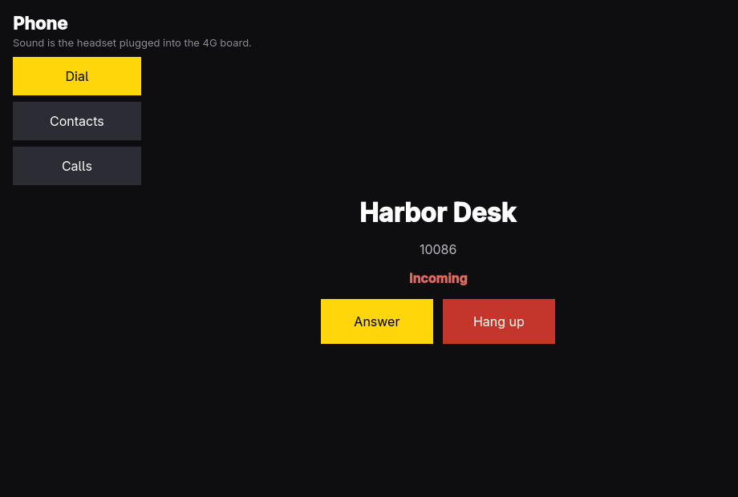

# Phone

Place, answer, and hang up voice calls on a 4G modem, and keep mobile data and texts on the Omarchy bar. Contacts and the call list stay on this computer. Sound comes from the headset plugged into the 4G board.



The launcher name is **Phone**. The bar shows **4G**, to the left of Network. Left-click opens data, texts, and the live call. Right-click toggles mobile data. The modem stays powered either way, so texts still arrive.

## Install

Omarchy, with ModemManager and a NetworkManager connection named `4g`. Another name can be set on the widget after it is installed. Build tools are `qmake6`, `make`, a C++ compiler, and Qt 6 (base, declarative, wayland, tools).

From a clone, for this user only, with no root password:

```sh
git clone https://github.com/peterpanstechland/handset.git
cd handset
./bin/install-user
```

That builds `handset`, puts it on `~/.local/bin`, and adds the `handset.cellular` bar widget. `~/.local/bin` needs to be on `PATH`, which it is on Omarchy.

To update later: `git pull` and `./bin/install-user` again.

A system package installs the binary for every user. It asks for your password. Each person then adds the bar for themselves:

```sh
cd pkgbuild
makepkg -si
handset-bar
```

`omarchy plugin add` only accepts a repository whose root is the plugin. This repository is the Phone window and the bar together, so use the installer above.

## Phone keys

| Key | Action |
| --- | --- |
| `0-9` `*` `#` `+` | Type a number |
| `Backspace` | Delete a digit |
| `Space` or `Enter` | Call, or answer an incoming ring |
| `A` | Answer |
| `H` | Hang up |
| `D` | Dial pad |
| `C` | Contacts |
| `L` | Calls |
| `?` | Show these shortcuts |
| `Q` | Quit |

`handset contacts --json` prints the address book and does not open the window.

## Bar

The menu lists the operator, a data switch, texts already stored on the modem, and the live call. **Phone** opens the window. An incoming ring opens the menu, posts a notification, and raises Phone when it is installed.

Open the menu from a terminal with `omarchy-shell handset.cellular open`. Move the button with `omarchy bar move handset.cellular --section right`.
